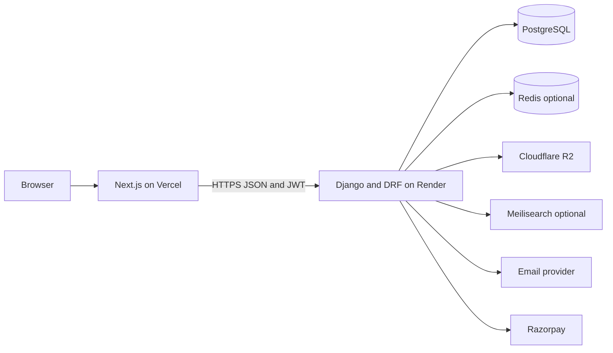
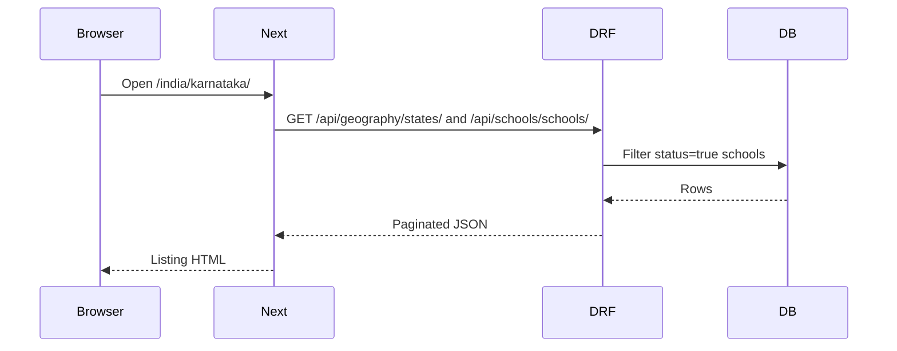
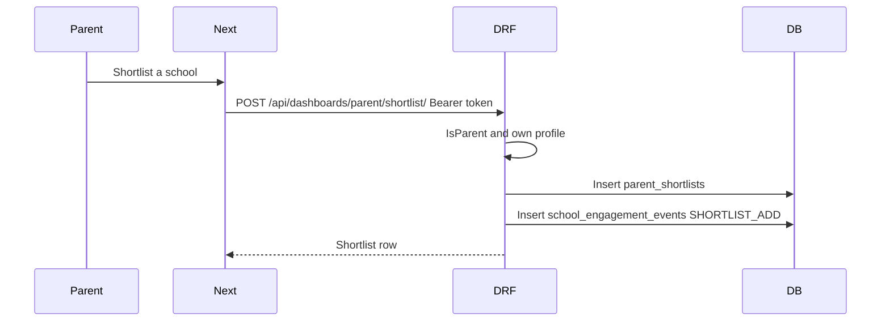

# 2. System architecture

## Runtime shape

The frontend calls the API through `frontend/lib/api.ts`. `API_BASE` is the configured backend origin. Authenticated calls send `Authorization: Bearer <access token>`.

A public page such as a school listing does this:

1. The App Router page reads the URL.
2. The page calls geography and school list endpoints.
3. Django filters `schools` and related tables.
4. JSON returns to the server component or client component.
5. The page renders cards, filters, and metadata.

A signed-in action adds the JWT, a permission check, and a database write. Some school-admin writes do not update the live row immediately. They insert a pending change row and return HTTP 202.

## Django project layout

Root URLconf: `backend/config/urls.py`. Settings: `backend/config/settings.py`.

| App | Path | Responsibility |
| --- | --- | --- |
| `geography` | `backend/apps/geography/` | Country, state, city, locality |
| `schools` | `backend/apps/schools/` | Schools, catalogues, media metadata, engagement, popularity, promotions |
| `fees` | `backend/apps/fees/` | Academic years, fee terms, structures, line items, public fee estimate |
| `users` | `backend/apps/users/` | User, profiles, shortlist, saved searches, password API |
| `admissions` | `backend/apps/admissions/` | Children, enquiries, counselling, application documents and messages |
| `reviews` | `backend/apps/reviews/` | Parent reviews and moderation status |
| `search` | `backend/apps/search/` | Suggestion API and Meilisearch sync. `models.py` is empty |
| `notifications` | `backend/apps/notifications/` | Email delivery log, in-app notices, preferences, OTP records |
| `dashboards` | `backend/apps/dashboards/` | Role dashboards and school-admin write endpoints |
| `guides` | `backend/apps/guides/` | Educational guides |
| `blogs` | `backend/apps/blogs/` | Blog categories, posts, images, subscribers |
| `subscriptions` | `backend/apps/subscriptions/` | Plans, school subscriptions, Razorpay payments |

`dashboards.models.RecentSchoolView` is the only dashboard table. Most dashboard views aggregate other apps.

## Request path

Authenticated example:

## Authentication boundary

- Default DRF authentication is `apps.users.otp_access.VerifiedEmailJWTAuthentication`.
- Default permission is `DjangoModelPermissionsOrAnonReadOnly`, then many views override it.
- Safe methods on catalogue viewsets are `AllowAny`. Writes on those viewsets require `IsPlatformAdmin` (staff admin, super admin, or Django superuser).
- School type records are read-only on the API (`SchoolTypeViewSet.http_method_names` is GET, HEAD, OPTIONS).
- Parents and school admins must complete email OTP before they receive tokens. Staff and super admins receive tokens directly from `POST /api/auth/jwt/token/`.
- Django Admin uses Django session login, separate from the Next.js JWT.

## Data ownership

| Data | Owner |
| --- | --- |
| Geography, boards, grades, facilities, academic years, fee terms | Platform staff through Django Admin or platform-admin API writes |
| A school’s descriptive fields, grades, facilities, photos, fees, resources | The assigned school admin proposes changes; staff approve them |
| Featured promotions and popularity weights | Platform staff in Django Admin |
| Children, shortlist, saved searches | The parent |
| An enquiry | The parent or guest who submitted it, the school it targets, and staff who assign it |
| Reviews | The parent creates them; staff publish or reject them |
| Blogs and guides | Staff in Django Admin |

## Background work

`CELERY_BEAT_SCHEDULE` in settings defines:

| Task | Schedule | Code |
| --- | --- | --- |
| `apps.schools.tasks.refresh_school_popularity` | Every hour at minute 0 | Recalculates scores and deletes events older than the rolling window |
| `apps.notifications.tasks.deliver_saved_search_alerts` | Every 6 hours | Emails parents about new schools matching saved searches |

`render.yaml` starts one web process and Redis. It does not declare a Celery worker or beat process. When Redis is configured, tasks are not eager, so these schedules run only if a worker and beat are started outside the blueprint, or if someone runs `manage.py send_saved_search_alerts`.

Meilisearch updates are signal-driven from `backend/apps/search/signals.py`. If Meilisearch is down, suggestions fall back to the database (`search/views.py`).

## Storage

School cover images and logos are URLs. The backend proxies objects under `/media/schools/<filename>` and `/media/day-schools/<filename>` (`backend/config/school_media.py`) from the R2 bucket. Blog images are Django `ImageField`s optimized in `apps.blogs.images`. Parent photos and application documents use private storage in `apps.admissions.storage`.

## Observability

- Liveness: `GET /healthz`
- Readiness: `GET /readyz`
- Logging: console, JSON when `DEBUG` is false
- Optional Sentry when `SENTRY_DSN` is set, with `send_default_pii=False`

## Pagination

Global default is cursor pagination, page size 20 (`config.pagination.BoardingEduCursorPagination`). School directory lists use `SchoolDirectoryPagination`, which is offset-based so parents can sort by rating or fee without unstable pages. Ordering of nullable fee and rating fields uses `NullsLastOrderingFilter`.
