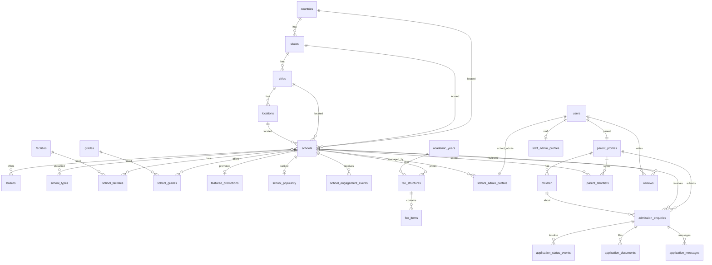

# 10. Database documentation

PostgreSQL is the system of record. Table names come from each model’s `Meta.db_table`. Primary keys are UUIDs unless noted. Django also creates its own tables (`django_migrations`, `django_admin_log`, `auth_permission`, and the SimpleJWT blacklist tables). Those are framework tables, not product entities.

This document does not list every column. It lists the fields that define behaviour.

## Relationship overview

## Geography

| Table | Model | Purpose | Key fields | Managed by | Shown on |
| --- | --- | --- | --- | --- | --- |
| `countries` | `Country` | Top of the place tree | `country_id` PK, `country_code`, `country_name`, `slug`, `status` | Staff | Listing URLs, filters |
| `states` | `State` | State or region | FK `country_id`, `state_code`, `slug`. Unique per country | Staff | State pages |
| `cities` | `City` | City | FK `state_id`, `city_code`, `slug`. Unique per state | Staff | City pages |
| `locations` | `Location` | Locality inside a city | FK `city_id`, `location_code`, `slug`. Unique per city | Staff | Locality pages and school address |

Deleting a place that schools still reference is blocked (`on_delete=RESTRICT`).

## School catalogues

| Table | Model | Purpose | Key fields | Managed by | Shown on |
| --- | --- | --- | --- | --- | --- |
| `boards` | `Board` | CBSE, ICSE, IB, and others | `board_id`, unique `board_code`, `slug` | Staff | Cards, filters, profile |
| `school_types` | `SchoolType` | Day, day boarding, boarding | `school_type_id`, unique `type_code` and `type_name` | Staff in Django Admin | Home categories |
| `grades` | `Grade` | Master grade list | `grade_id`, unique `grade_code`, `grade_name`, `sort_order` | Staff | Fees, enquiries, children |
| `facilities` | `Facility` | Catalogue item and category | `facility_id`, `facility_code`, `category`, `facility_name` | Staff | Facility section after a school links it |
| `school_directory_faqs` | `SchoolFAQ` | Reusable answers | Optional FKs to place, board, and school type. `status` defaults false | Staff | Profile FAQ and listing FAQ |

Implicit many-to-many tables link `schools` to `boards` and `school_types` (Django M2M). They are not given custom `db_table` names.

## Schools and content

| Table | Model | Purpose | Important fields | Who manages | Where it appears |
| --- | --- | --- | --- | --- | --- |
| `schools` | `School` | The public school | `school_id` PK, unique `school_code`, unique `slug`, required country, state, city, optional location, gender, address, `status`, `verification_status`, `is_featured`, `admission_open`, `about`, `tagline`, `principal_name`, `student_teacher_ratio`, logo and image URLs, lat/lng | Staff create and publish. School admin proposes edits | Cards and profile |
| `school_facilities` | `SchoolFacility` | Facility attached to one school | Unique `(school, facility)`, `available`, `quantity_or_capacity`, `description` | School admin via approval, or staff directly | Facilities and infrastructure |
| `school_grades` | `SchoolGrade` | Grade the school offers | Unique `(school, grade)`, seats, entry ages, `is_active` | Same | Fees, admissions, filters |
| `school_photos` | `SchoolPhoto` | Gallery image URL | `photo_url`, `category`, `sort_order`, `status` | Same | Photos |
| `school_videos` | `SchoolVideo` | Video URL | `video_url`, optional thumbnail, category | Staff, and approval type `VIDEO` | Photos and videos |
| `school_admission_resources` | `SchoolAdmissionResource` | Brochure or required document | `resource_type`, `title`, `document_url` | School admin via approval | Admissions |
| `featured_promotions` | `FeaturedPromotion` | One promotion per school | `label`, `priority`, `is_active`, `starts_on`, `ends_on`, banner and copy | Staff only | Home and featured filter |
| `school_profile_changes` | `SchoolProfileChange` | Pending profile JSON | One pending row per school | School admin submits, staff reviews | Not public |
| `school_content_changes` | `SchoolContentChange` | Pending facility, grade, photo, fee, resource, or video change | Unique pending `(school, change_key)` | Same | Not public |
| `school_verification_events` | `SchoolVerificationEvent` | Verification audit | Previous status, new status, note, actor | Staff | Admin history |

## Fees

| Table | Model | Purpose | Relationships | Who | Where |
| --- | --- | --- | --- | --- | --- |
| `academic_years` | `AcademicYear` | Year code such as `2026-27` | `is_current` | Staff | Enquiry form, fees |
| `fee_terms` | `FeeTerm` | Term inside a year | FK academic year. Unique `(academic_year, term_code)` | Staff | Fee structure |
| `fee_structures` | `FeeStructure` | One published master per school per year | FK school, academic year, optional fee term. `published` | Staff directly, school admin by approval | Profile fees when published |
| `fee_items` | `FeeItem` | A priced line | FK structure, optional grade and school type, category, amount, frequency, optional stream | Same | Fee section and calculator |

## Users and parent tools

| Table | Model | Purpose | Relationships | Who | Where |
| --- | --- | --- | --- | --- | --- |
| `users` | `User` | Login account | `role`, phone, `is_email_verified`, `is_active`. Extends Django’s user | Self-serve for parents and school signup. Staff create staff | All authenticated areas |
| `parent_profiles` | `ParentProfile` | Parent extras | PK is `user_id`. Address, occupation, photo, contact method | Parent | Profile section |
| `school_admin_profiles` | `SchoolAdminProfile` | School binding | PK is `user_id`. Required FK `school_id`, designation | Staff assign | School console |
| `staff_admin_profiles` | `StaffAdminProfile` | Staff label | PK is `user_id`. Designation, department | Staff | Not a public page |
| `parent_shortlists` | `ParentShortlist` | Saved schools | Unique `(parent_profile, school)`, note | Parent | Shortlist |
| `saved_searches` | `SavedSearch` | Alert filters | FKs to place. M2M types, boards, facilities | Parent | Saved searches |
| `saved_search_matches` | `SavedSearchMatch` | Already-notified pair | Unique `(saved_search, school)` | System | Not shown as a screen |
| `shortlist_admission_notices` | `ShortlistAdmissionNotice` | Admission-open alert dedupe | Unique `(parent_profile, school)` | System | Notification only |
| `parent_recent_school_views` | `RecentSchoolView` | Last open time | Unique `(parent_profile, school)` | Parent browsing | Recently viewed |

## Admissions

| Table | Model | Purpose | Notes | Who | Where |
| --- | --- | --- | --- | --- | --- |
| `children` | `Child` | Child of a parent | FK parent, optional current grade | Parent | My children, enquiry |
| `admission_enquiries` | `AdmissionEnquiry` | Lead and application | Required school and academic year. Parent and child nullable for guests. Guest name, email, phone, child fields. CRM status and application status. `assigned_to` is a staff user | Parent, guest, school, staff | Profile enquiry, parent applications, school leads, Django Admin |
| `application_status_events` | `ApplicationStatusEvent` | Timeline | Status, remarks, instructions | Written when application status changes | Parent application detail |
| `application_documents` | `ApplicationDocument` | Private file | Type, review status, uploader | Parent uploads, reviewers verify | Documents |
| `application_messages` | `ApplicationMessage` | Thread on one enquiry | Author, body | Parent and school or staff | Messages |
| `counselling_requests` | `CounsellingRequest` | Platform counselling lead | Contact fields, M2M states, cities, grades, types, boards, optional school | Visitor submits, staff updates status | Counselling form, Django Admin |

## Reviews, content, notifications, billing

| Table | Model | Purpose | Who | Where |
| --- | --- | --- | --- | --- |
| `reviews` | `Review` | 1–5 rating plus optional sub-ratings | Parent writes, staff moderates | Profile after publish |
| `guide_categories` | `GuideCategory` | Guide grouping | Staff | `/guides/` |
| `guide_articles` | `GuideArticle` | Guide. PK is `slug`. `sections` JSON | Staff | `/guides/{slug}/` |
| `blog_categories` | `BlogCategory` | Blog grouping | Staff | Blog index |
| `blog_posts` | `BlogPost` | Article, SEO fields, status | Staff | `/blogs/{slug}/` |
| `blog_images` | `BlogImage` | Inline upload | Staff | URL copied into HTML |
| `blog_subscribers` | `BlogSubscriber` | Newsletter consent | Public form | Not a public list |
| `parent_notifications` | `ParentNotification` | In-app notice | System | Parent notifications |
| `notification_preferences` | `NotificationPreference` | Email consent and unsubscribe token | Parent | Settings and unsubscribe page |
| `otp_records` | `OtpRecord` | OTP fallback when Redis is not the OTP backend | System | Not shown |
| Email delivery table | `EmailDelivery` | Provider log. No custom `db_table`, so Django’s default app table name | System | Django Admin |
| `subscription_plans` | `SubscriptionPlan` | Price, duration, lead access, optional quota | Staff | School plans page |
| `school_subscriptions` | `SchoolSubscription` | Term for one school | Created after verified payment | School subscription page |
| `subscription_payments` | `SubscriptionPayment` | Razorpay order and payment ids | System after checkout | Payment history |

`EmailDelivery` does not set `db_table`, so its physical name is the Django default `notifications_emaildelivery`.

## Engagement and ranking

| Table | Model | Purpose |
| --- | --- | --- |
| `school_engagement_events` | `SchoolEngagement` | One row per school, event type, identity hash, and UTC date |
| `school_engagement_weights` | `SchoolEngagementWeight` | Weight and enabled flag per event type |
| `school_popularity_config` | `SchoolPopularityConfig` | Single row `config_id = 1` |
| `school_popularity` | `SchoolPopularity` | One score row per school. PK is `school_id` |

Scoring is documented in [Popularity](14_SCHOOL_POPULARITY_AND_FEATURED_SYSTEM.md).

## Constraints that protect data

- A parent cannot shortlist the same school twice.
- A saved search cannot record the same school match twice.
- A parent cannot have two reviews for one school.
- A school cannot have two pending profile changes.
- A school cannot have two pending content changes with the same key.
- A school cannot have two fee structures for one academic year.
- A school cannot link the same facility or grade twice.
- Review rating must be between 1 and 5.
- Promotion end date cannot be before the start date.
- Place codes and slugs are unique within their parent place.

## Who sees which rows

Public queries add `schools.status = true` and, for fees and photos, their own published or active flags. Verification status does not by itself hide a school. A pending self-registered school is hidden because registration sets `status=False`.

Parents are limited by `parent_profile` on children, shortlists, saved searches, and their enquiries. School admins are limited by `school_admin_profiles.school_id`. Staff queries are unscoped unless a Django Admin mixin applies.
